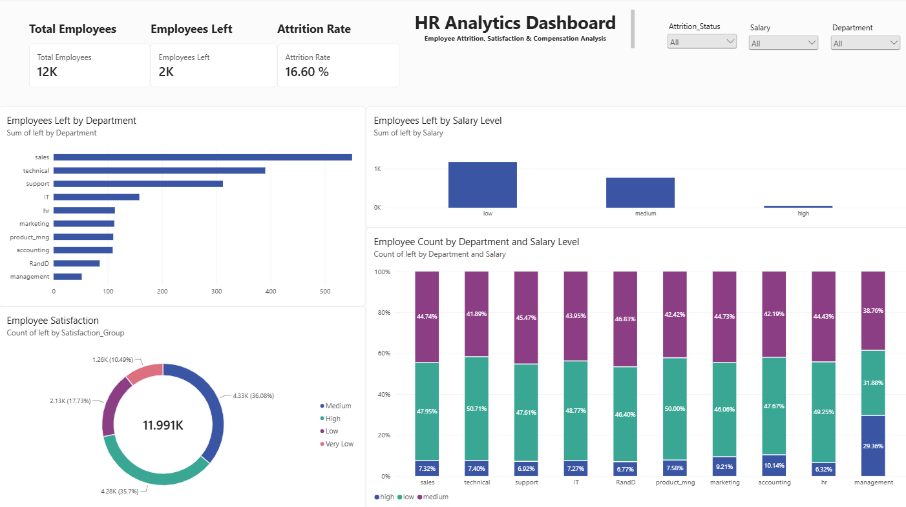

# HR Analytics Dashboard (Power BI)

## Project Overview

This project presents an interactive HR Analytics Dashboard developed in Power BI. The dashboard analyzes employee attrition, satisfaction, salary distribution, and departmental trends to support workforce decision-making.

## Dashboard Preview

## Key Metrics

- Total Employees: 11,991
- Employees Left: 1,991
- Attrition Rate: 16.60%

## Dashboard Features

- Employee Attrition Analysis
- Department-wise Attrition Tracking
- Salary-Level Attrition Analysis
- Employee Satisfaction Distribution
- Department Salary Distribution
- Interactive Slicers and Filters

## Key Insights

### Attrition Analysis
- Sales department recorded the highest employee attrition.
- Technical department had the second-highest attrition rate.

### Salary Analysis
- Employees in the low salary group account for the largest share of departures.
- High salary employees have the lowest attrition.

### Satisfaction Analysis
- Most employees fall within Medium and High satisfaction groups.
- Very Low satisfaction represents the smallest employee segment.

## Tools Used

- Power BI
- DAX
- Microsoft Excel
- Data Visualization

## Author

Nor Izzati Mohd Zahir
